👋 Hi, I'm Dev Chaudhary

<h3 align="center">Software Developer | Trainee Engineer @ BEL | HPC Enthusiast</h3>

🚀 About Me

I'm Dev Chaudhary, a Software Developer currently working as a Trainee Engineer at Bharat Electronics Limited (BEL).

I specialize in software development and enjoy building scalable applications, developing modern web solutions, and exploring high-performance computing technologies.

💼 Currently working as Trainee Engineer at BEL.
🎓 CDAC Bangalore Alumni – High-Performance Computing.
💻 Interested in Full-Stack Development and Software Engineering.
⚡ Exploring Multiprocessing, Parallel Computing and System Optimization.
🌱 Continuously learning modern technologies and software architectures.
🎯 Passionate about building efficient, reliable and scalable solutions.
🛠️ Tech Stack
💻 Programming Languages

🌐 Frontend Development

⚙️ Backend & Database

🔧 Tools & Platforms

## 📊 GitHub Statistics

  
  

🔥 Contribution Streak

📈 Contribution Activity

🎯 Areas of Interest
🚀 High-Performance Computing
⚙️ Parallel & Distributed Computing
🌐 Full-Stack Web Development
🧠 Artificial Intelligence
💻 Software Architecture
🔥 Performance Optimization
🤝 Let's Connect

<h3 align="center">💻 CODE • INNOVATE • OPTIMIZE • REPEAT 🚀</h3>

<i>"Turning ideas into efficient, scalable and impactful software."</i>

